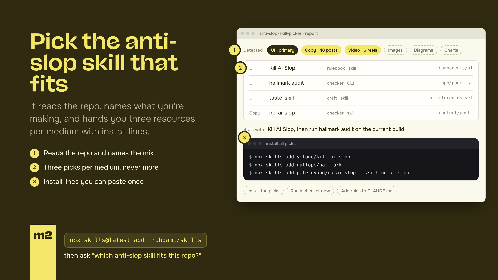

# Anti-Slop Skill Picker



Every medium has its own AI default. Text gets em dashes and "delve". UI gets purple gradients and three icon cards. Images get glossy skin and "cinematic" light. Video gets linear fades. Diagrams get uniform box grids. Charts get 3D pies. One anti-slop rulebook can't cover all of them, so this skill reads the repo, works out what you're making, and hands you the few resources that fit.

## Usage

```
/anti-slop-skill-picker [path or task]
```

## Workflow

### 1. Read the context (no changes)

Run the detector first. It is plain Node, no dependencies, and it never edits anything:

```
node scripts/detect.mjs <path>          # table
node scripts/detect.mjs <path> --json   # machine-readable
```

It counts files and dependencies per medium and prints the evidence paths. Then read the user's request. **The request wins over the repo**: "write the launch post" in a Next.js repo is a text task; the UI picks become a footnote.

| Medium | What the detector counts |
|---|---|
| Text and copy | `.md`, `.mdx`, `.txt`, `.rst`; `content/`, `docs/`, `posts/`, `blog/`, `newsletter/` folders; README and marketing strings |
| UI and web design | `.tsx`, `.jsx`, `.vue`, `.svelte`, `.astro`, `.html`, `.css`; react, vue, svelte, astro, next, nuxt, tailwindcss, shadcn, radix, base-ui |
| Images | `prompts/` folders and `*prompt*` files; image-generation calls (`images.generate`, flux, dall-e, midjourney, nano-banana, imagen); OG or cover scripts; replicate, fal, openai image deps |
| Video and motion | remotion, gsap, lottie, framer-motion, motion, hyperframes; `.mp4`, `.webm`, `.mov`, `.lottie`; `compositions/`, `reels/`, `marketing/`, `video/`; ffmpeg scripts |
| Diagrams | `.mmd`, `.excalidraw`, `.drawio`, `.puml`; ```` ```mermaid ```` blocks in markdown; mermaid, excalidraw deps; `architecture/` docs |
| Charts and data | d3, recharts, chart.js, vega, plotly, echarts, observable plot, nivo; `.ipynb`; `.csv` and `.parquet` data; matplotlib, seaborn, altair imports; `dashboard/` |

Rules for the mix:

- A medium is **present** above a small threshold: three files or one dependency. Below that, say so in one line and make no picks for it.
- **Primary** is the medium with the most evidence; the user's request breaks ties. Up to two **secondaries**.
- An empty folder, or no repo at all: ask which medium. Do not guess from the folder name.
- Count what you find. Never call a medium present from one file.

### 2. Report the mix

One line, then the evidence: "This repo is mostly UI (Next.js + Tailwind, 212 components), with blog copy (48 posts in `content/`) and OG images (`scripts/og.mjs`)." Name the primary medium and the secondaries.

### 3. Pick from the catalog

Open [CATALOG.md](CATALOG.md). For the **primary** medium pick at most three: one **rulebook** (stops slop while building), one **checker** (finds slop after), and one **craft** skill (makes it distinctive rather than only clean). For each **secondary** medium pick at most two. Nothing for media that are not present.

Take the "start here" rows unless the evidence points to an "also" row: React detected, offer fluid-functionalism; HyperFrames or GSAP detected, offer motionmaxxing; no brand tokens anywhere, offer brandkit. Give the install line exactly as the catalog has it, and a one-line reason that names the file or package the detector found.

### 4. Offer next steps

Ask before installing anything. Offer three things: install the picks, run a checker on the current output, or add the rules to `CLAUDE.md` or `AGENTS.md`. Then stop.

## Report format

Required shape, no substitutes:

**Detected:** primary medium, secondary media, the evidence (files or packages, with counts).

| Medium | Pick | Type · form | Why for this repo | Install |
|---|---|---|---|---|
| UI | Kill AI Slop | rulebook · skill | Tailwind + shadcn defaults in `components/ui` | `npx skills add yetone/kill-ai-slop` |
| UI | hallmark | checker · skill | audits the rendered page, no edits | `npx skills add nutlope/hallmark` |
| UI | taste-skill | craft · skill | reference-first direction before more components | `npx skills add https://github.com/Leonxlnx/taste-skill --skill "design-taste-frontend"` |
| Text | no-ai-slop | checker · skill | 48 posts in `content/`, drafted with an agent | `npx skills add petergyang/no-ai-slop --skill no-ai-slop` |

**Start with:** the one resource to use first, in one line.

**Install all picks:** one fenced `bash` block with every install line, one per line, so the user can paste once. Lines that are a prompt or a reference get a comment instead of a command.

## Rules

- **Read-only.** Recommend and explain. Never install, edit config or run a networked checker without asking.
- **Evidence, not vibes.** Every pick names the file, package or request that triggered it.
- **Three per medium, max.** Nothing for media that are not present. A long list is its own kind of slop.
- **Clean isn't distinctive.** If the user's goal is to stand out, include one craft pick, not only a checker.
- **Name the form.** Say whether a pick is a skill, a CLI, an MCP, a plugin, a prompt or a reference, so "install" means something before they run it.
- **Never invent resources.** Only recommend what is in `CATALOG.md`, or what you verified exists today. Say so when a medium has no good pick yet.
- **Never recommend this skill.**
- **Prompts count.** Two moves that are not tools and still worth offering for motion: review the piece against Lasseter's twelve principles of animation; name scroll behaviour precisely (pin, scrub, parallax, reveal) instead of "animate on scroll".

## Keeping the catalog honest

Every row in `CATALOG.md` carries the date it was verified. Re-check a row before relying on it if that date is older than three months: fetch the repo, confirm the install line, note the stars or install count. A resource without a primary source never goes in. If a row dies, move it to the "Dropped" list at the bottom with the reason, so nobody re-adds it.
